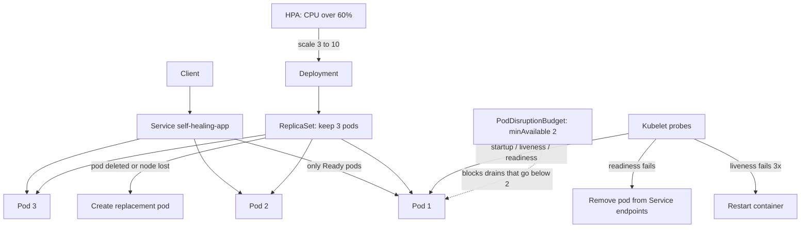

# Kubernetes Self-Healing Demo

A small, hands-on project that shows how Kubernetes keeps an app running on its own: it restarts crashed containers, replaces deleted pods, stops sending traffic to unhealthy pods, protects availability during node drains, and scales out under load.

> This repo is meant to be run on a local cluster (kind or minikube). Nothing here is deployed anywhere by default.

## What's inside

| Path | What it does |
| --- | --- |
| `app/` | A tiny Flask app with `/healthz`, `/readyz`, `/startupz` plus failure switches (`/crash`, `/fail/liveness`, `/fail/readiness`, `/burn`) |
| `k8s/base/` | Namespace, Deployment (3 replicas, startup/liveness/readiness probes, resource requests and limits), Service, PodDisruptionBudget, HorizontalPodAutoscaler, all wired with Kustomize |
| `k8s/overlays/dev/` | Example Kustomize overlay (caps the HPA at 5 pods) |
| `helm/self-healing/` | The same setup as an optional Helm chart |
| `scripts/` | Cluster setup for kind and minikube, the failure simulator, and cleanup |

## How the self-healing works



| Mechanism | Failure it handles |
| --- | --- |
| `restartPolicy: Always` | Process crashes, the kubelet restarts the container |
| Liveness probe (`/healthz`) | App is running but stuck, the container is restarted |
| Readiness probe (`/readyz`) | App can't serve right now, it's taken out of the load balancer until it recovers |
| Startup probe (`/startupz`) | Slow warm-up, liveness waits until startup succeeds so the pod isn't killed early |
| ReplicaSet (`replicas: 3`) | Pod deleted or node lost, a new pod is scheduled |
| PodDisruptionBudget | Node drain or upgrade, at least 2 pods stay up |
| HPA | CPU spike, more pods are added (and removed later) |
| Resource requests/limits | Noisy neighbours, fair scheduling and OOM protection for the node |

## Prerequisites

- Docker
- `kubectl`
- Either [kind](https://kind.sigs.k8s.io/) or [minikube](https://minikube.sigs.k8s.io/)
- Optional: Helm 3

## Step-by-step demo

### 1. Create a cluster and deploy

With kind (1 control plane plus 2 workers):

```bash
./scripts/setup-kind.sh
```

Or with minikube (2 nodes):

```bash
./scripts/setup-minikube.sh
```

Both scripts build the image, install metrics-server (needed by the HPA), apply `k8s/base`, and wait for the rollout.

### 2. Watch the cluster in a second terminal

```bash
./scripts/simulate-failure.sh watch
```

### 3. Break things and watch them recover

```bash
# Delete one pod: the ReplicaSet creates a replacement within seconds
./scripts/simulate-failure.sh kill-pod

# Delete every pod: all 3 come back
./scripts/simulate-failure.sh kill-all

# Crash the process: the RESTARTS count goes up and the pod stays
./scripts/simulate-failure.sh crash

# Make /healthz fail: the liveness probe restarts the container after about 15s
./scripts/simulate-failure.sh liveness

# Make /readyz fail: the pod shows 0/1 READY and drops out of the Service endpoints
./scripts/simulate-failure.sh readiness

# Drain a node: the PodDisruptionBudget keeps at least 2 pods available
./scripts/simulate-failure.sh drain
kubectl uncordon <node-name>

# Generate CPU load for 2 minutes: the HPA scales from 3 up to as many as 10 pods
./scripts/simulate-failure.sh load
kubectl -n self-healing get hpa -w
```

Useful commands while you experiment:

```bash
kubectl -n self-healing describe pod <pod>          # see probe failures and restart events
kubectl -n self-healing get events --sort-by=.lastTimestamp
kubectl -n self-healing get rs                      # the ReplicaSet behind the Deployment
```

### 4. Optional: deploy with Kustomize overlay or Helm

```bash
kubectl apply -k k8s/overlays/dev
# or
helm install self-healing ./helm/self-healing -n self-healing --create-namespace
```

### 5. Clean up

```bash
./scripts/cleanup.sh
kind delete cluster --name self-healing   # or: minikube delete
```

## Run the app locally (no cluster)

```bash
cd app
pip install -r requirements.txt
STARTUP_DELAY_SECONDS=2 python app.py
curl localhost:8080/healthz
```

## License

[MIT](LICENSE)
